# SLAFURRY STUDIOS — WEBSITE
The official (for now) website of Slafurry Studios — a small indie game studio built on rapid prototyping and unique ideas.

<p align="center">
  
</p>
<br>

<p align="left">
  
  
  
</p>

<p align="center">
  <a href="https://www.slafurrystudios.com"><b>www.slafurrystudios.com</b></a>
</p>

---

## ABOUT
The website for Slafurry Studios — home to our games, devlogs, and whatever else we're up to. Built with Next.js (App Router), Prisma on Supabase Postgres, Supabase Auth and Storage, and deployed on Vercel. Everything public is editable from a built-in admin panel, so new games and posts never need a code change.

---

## FEATURES

### Studio landing page
Hand-drawn pixel-frame style, the upcoming project front and centre, and a single button to the games.

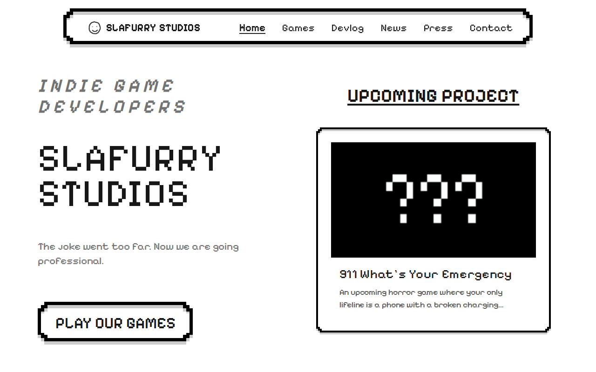

### Game portfolio
A featured game up top and every other project in a grid, each with its cover, status badge and description.

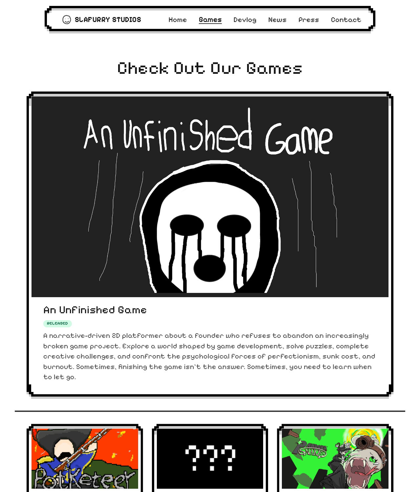

### Game pages
Every game gets its own page with cover art, release status, the full write-up and links to play it.

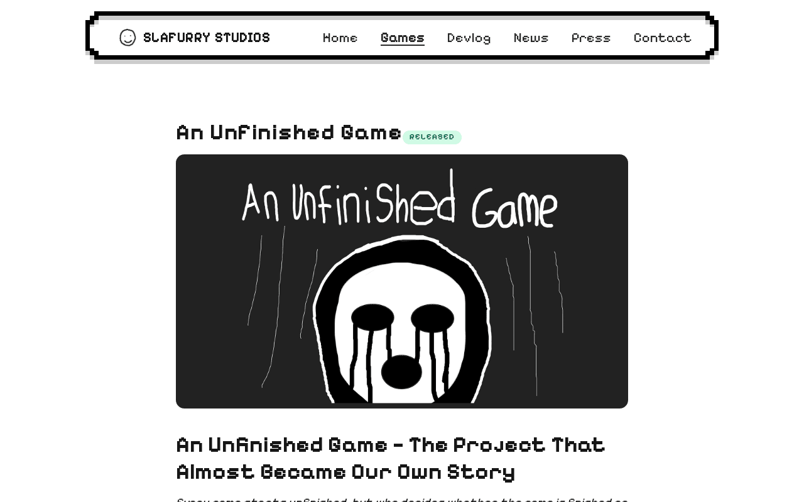

### Devlog and news, with tags and search
Two separate feeds. Filter by tag or search as you type, and subscribe through RSS (`/devlog/rss.xml`, `/news/rss.xml`).

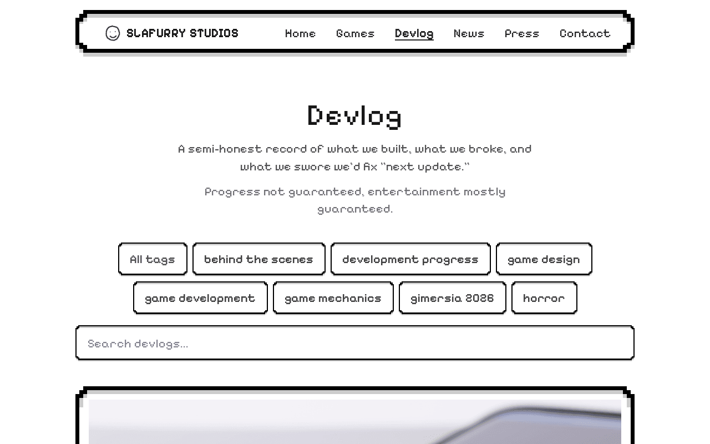

### Article reader with comments
Rich-text posts written in the admin editor, with author, date and tags. Visitors can comment; comments appear after moderation.

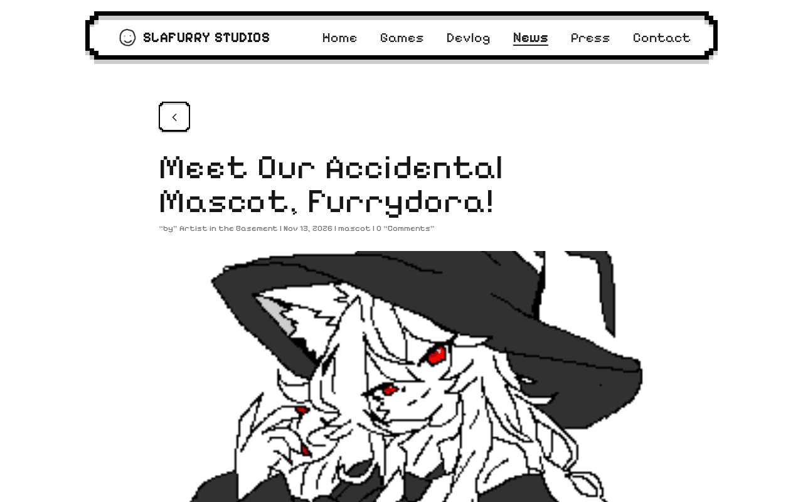

### Press kit
Logos, character art and banners ready to download, plus press releases and a contact for press inquiries.

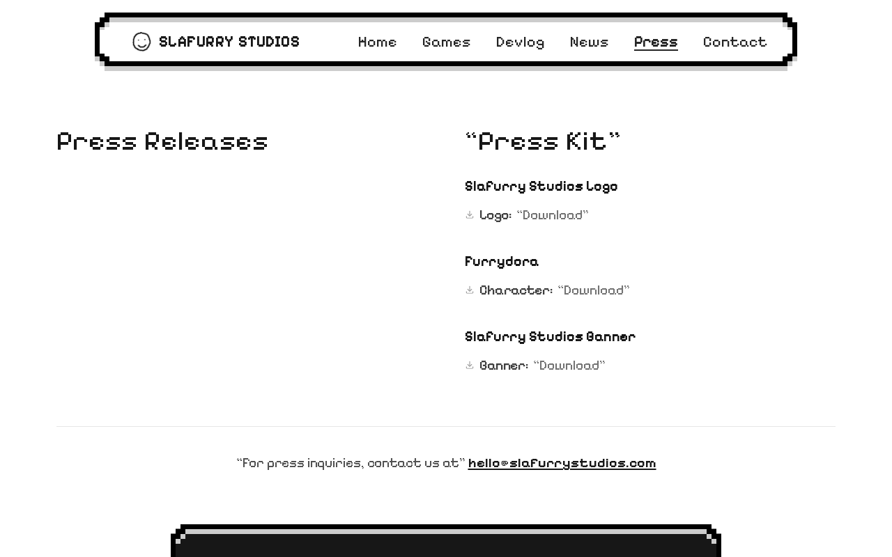

### Contact
Direct email links for general and business inquiries, plus a contact form protected by Cloudflare Turnstile, a honeypot and rate limiting.

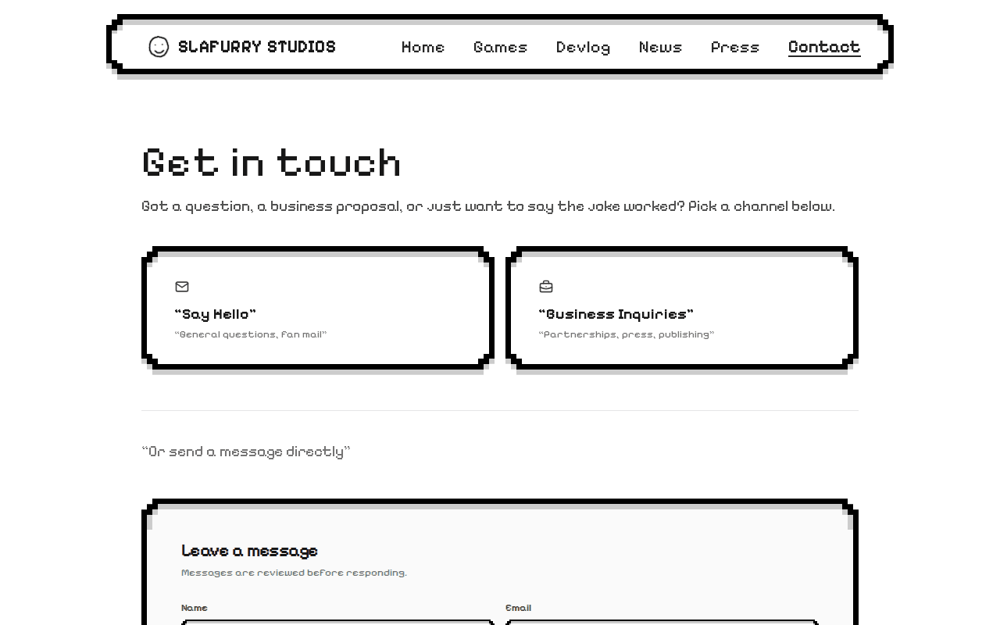

### Privacy-first analytics
Page views are only counted after a visitor says yes. No IP addresses, no ad trackers, and Global Privacy Control is respected. Visitors can change their choice from the footer, and [`/privacy`](https://www.slafurrystudios.com/privacy) explains exactly what's stored. Old visit records are deleted after 13 months.

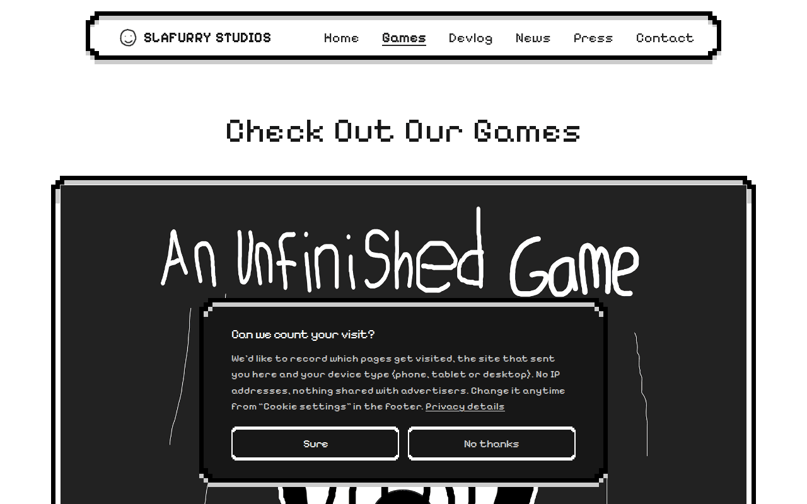

### Works on phones
Every page is responsive, with a collapsible menu on small screens.

<p align="center">
  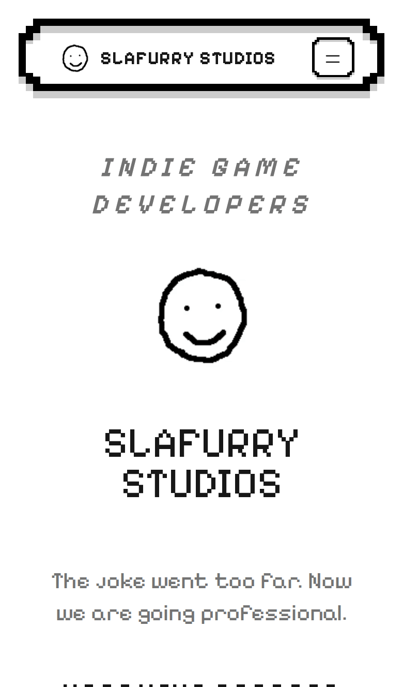
</p>

### Admin: games management
Add, edit, hide and drag-to-reorder games. The order here is the order on the site.

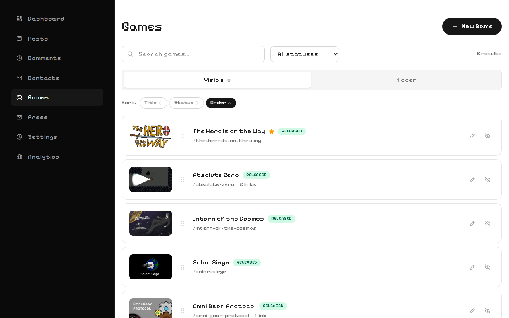

### Admin: post editor
A rich-text editor (TipTap) for devlogs and news, with headings, lists, quotes, links, images, code and autosave. Everything is sanitized before it's shown to visitors.

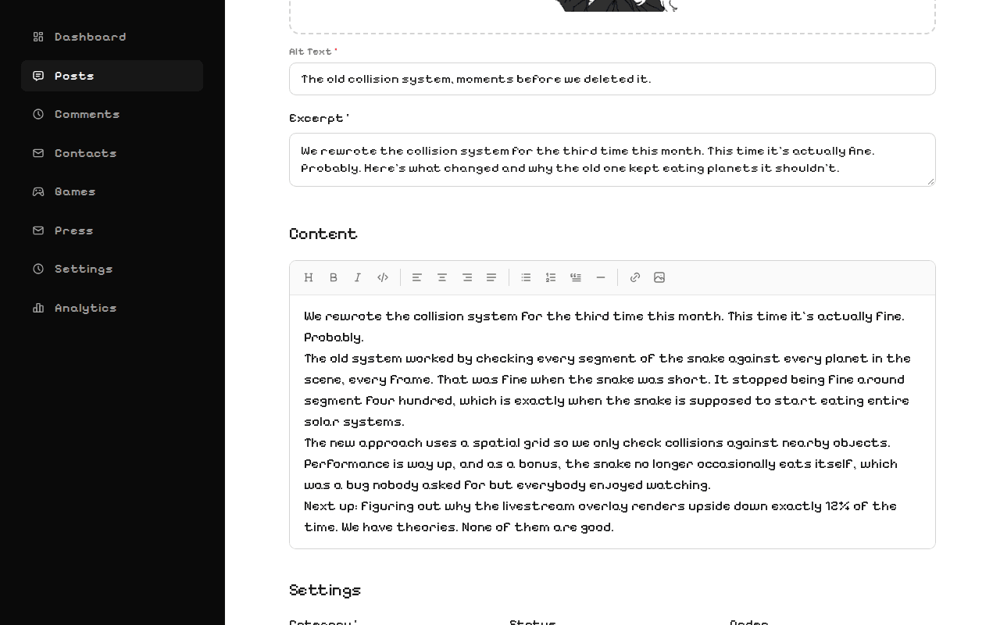

### Admin: comment moderation
Approve, reject or delete comments one at a time or in bulk, with search and filters.

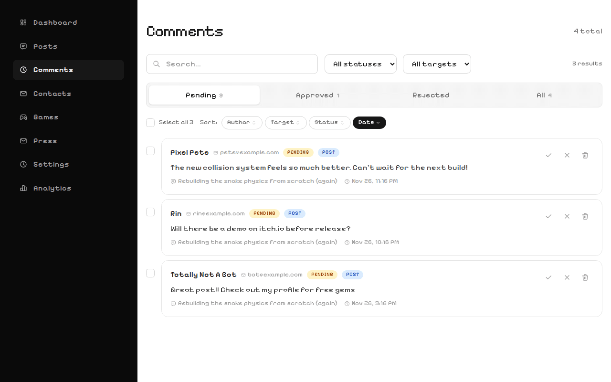

### Admin: analytics
Top pages, top referring sites and devices for the last 7, 30 or 90 days.

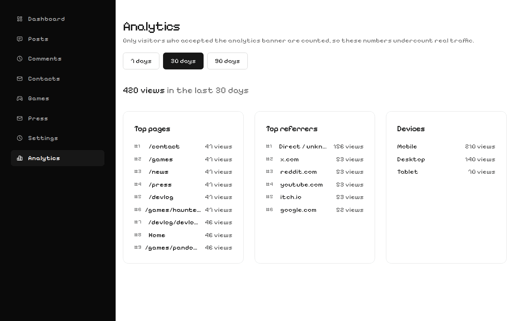

<sub>Admin screenshots use demo data, not real visitors or comments.</sub>

### Also under the hood
- **Admin access** is an allowlist (`ADMIN_EMAILS` plus the `AdminUser` table), checked on every admin page and API route. Creating, editing and deleting games, posts, press items, comments and contacts is recorded in an audit log.
- **Security headers**, CSRF checks on admin writes and shared rate limits for login, comments, contact and analytics.
- **SEO**: a generated sitemap and robots.txt, real 404 status codes, and Open Graph metadata for sharing.

---

## GETTING STARTED

### Prerequisites
- Node.js 22 or newer (CI runs on 22)
- npm
- A Supabase project (URL, publishable key and secret key), or Docker for a local Postgres

### Setup
```bash
git clone https://github.com/Slafurry-Studios/Slafurry-Website
cd Slafurry-Website
npm install
```

Copy the example env file and fill in your Supabase and database credentials. Every variable is explained in it:
```bash
cp .env.example .env
```

Then run the dev server (`npm install` already generated the Prisma client):
```bash
npm run dev
```

Open `http://localhost:3000`.

To work without a Supabase account, run everything on a local Docker Postgres instead: see [`docs/DATABASE.md`](docs/DATABASE.md).

---

## DATABASE

Prisma on Supabase PostgreSQL, with row-level security enabled on every table. Main models: Game, Post, Comment, PressRelease, PressKitAsset, ContactMessage, PageView, AuditLog, SiteSettings, SocialLink and AdminUser.

- Schema: `prisma/schema.prisma`
- Seed data: `prisma/seed.ts` (`npm run db:seed`, safe to re-run)
- Local Docker database: [`docs/DATABASE.md`](docs/DATABASE.md)

The site is English only, with no locale routing.

---

## TESTING

```bash
npm test
```

This runs `vitest run` (unit tests in `tests/unit/`) followed by `playwright test` (e2e tests in `tests/e2e/`). Run `npm run build` first: Playwright serves the production build. Install the browser once with `npx playwright install chromium`.

| Spec | Covers | Needs |
|---|---|---|
| `homepage.spec.ts` | Homepage renders | — |
| `not-found.spec.ts` | Missing pages return a real 404 | — |
| `admin-authz.spec.ts` | Non-admins get 401/403/404 on admin pages and APIs | `NON_ADMIN_TEST_EMAIL` / `NON_ADMIN_TEST_PASSWORD` for the signed-in part |
| `admin-qa.spec.ts` | Full admin panel QA (games, posts, comments, press, settings and more) | `ADMIN_TEST_EMAIL` / `ADMIN_TEST_PASSWORD` |

Tests that need credentials skip without them; never commit real ones. `npm run test:db` runs the unit tests against the local Docker database, including the Postgres rate-limit tests.

---

## DEPLOYMENT

Production runs on **Vercel**, with `www.slafurrystudios.com` as the canonical domain.

- Set every variable from `.env.example` in the Vercel project settings. `NEXT_PUBLIC_APP_URL` should be `https://www.slafurrystudios.com`.
- `ADMIN_EMAILS` decides who becomes an admin on first sign-in.
- `CRON_SECRET` enables the daily data-retention job defined in `vercel.json`.
- Database migrations in `prisma/migrations/` are applied to Supabase by hand. Never run `prisma migrate reset` or `db push` against production.

---

## TEAM
| Name | Role |
|---|---|
| Lord Zaini | Programmer |
| Althaf2406 | Programmer |
| csw | Emotional support pet |
| Alter | QA |

---

## VERSIONING & RELEASE

The project follows [Semantic Versioning](https://semver.org/spec/v2.0.0.html) (`MAJOR.MINOR.PATCH`, git tags `vMAJOR.MINOR.PATCH`). See [`CHANGELOG.md`](CHANGELOG.md) for every release.

- `feat` (backward-compatible feature) → MINOR bump
- `fix`/`perf` (backward-compatible fix) → PATCH bump
- Breaking change → MAJOR bump
- `docs`, `test`, `chore`, `ci`, `build`, `style`, `refactor` → no release

Conventional Commits are used (`<type>(<scope>): <summary>`). Changes are logged in `CHANGELOG.md` under `## [Unreleased]` (feat → Added, fix → Fixed, removals → Removed); breaking entries are prefixed with `**BREAKING:**` plus a short migration note.

Version headings, tags, and releases are cut only by the deployer via `gh release`. Never create a version heading or tag manually.

---

## CONNECT
<p align="left">
  <a href="https://github.com/Slafurry-Studios"></a>
  <a href="https://www.linkedin.com/company/slafurry-studios/"></a>
  <a href="https://slafurrystudios.itch.io/"></a>
</p>
